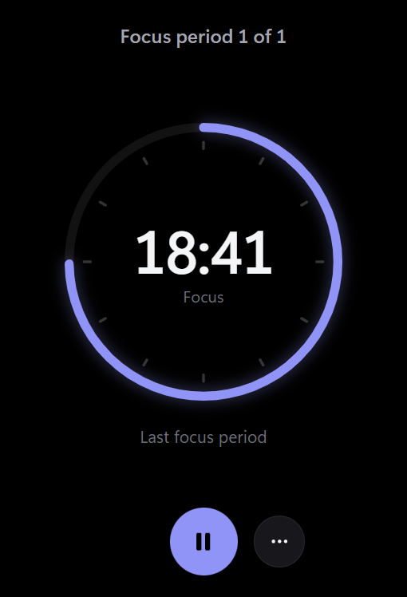

<div align="center">

# Umbra

**Desktop widgets that live on your wallpaper.**

Crisp, true-black widgets pinned under your apps on Windows. Sandboxed, scriptable, and open to anyone who wants to build one.

[](https://github.com/AmineChr54/umbra/releases/latest)
[](https://github.com/AmineChr54/umbra/releases)

[](LICENSE)

**[Download](https://github.com/AmineChr54/umbra/releases/latest)** · [Website and docs](https://aminechr54.github.io/umbra/) · [Build a widget](CONTRIBUTING.md) · [Automate it](#automate-umbra-cli-scripts-and-ai-agents) · [Roadmap](https://github.com/users/AmineChr54/projects/5)

<br>

<table>
  <tr>
    <td align="center" valign="top"><br><br></td>
    <td align="center" valign="top"></td>
    <td align="center" valign="top"><br></td>
    <td align="center" valign="top"></td>
  </tr>
</table>

</div>

## Why Umbra

- **It stays where it belongs.** Widgets sit under every window, never steal focus, stay visible with Win+D and start with Windows.
- **It's sharp.** Opaque true-black windows with DWM-rounded corners keep full ClearType text. On OLED, the black pixels are off, so each card seems to float on your wallpaper.
- **It's safe.** Each widget can only reach the HTTPS hosts it declares. Everything else is blocked by the host app, and updates that ask for new access wait for your OK.
- **It's yours to extend.** A widget is a folder of HTML, CSS and JS. Publish one with a pull request, or ask an AI agent to write one for you over MCP.

## Install

Download **[`UmbraSetup.exe`](https://github.com/AmineChr54/umbra/releases/latest)** and run it. It installs per-user (no admin prompt) and asks whether Umbra should start with Windows.

Umbra then lives in the tray. Click the tray icon (or open Umbra from the Start menu) for **Settings**, and go to **Browse** to add your first widgets. A dot on the tray icon means an Umbra update is ready.

On Linux, see [Install on Linux](#install-on-linux).

<details>
<summary><b>Portable copy</b></summary>

Download `Umbra-<version>-portable.zip`, unzip it anywhere and run `Umbra.exe`. The `portable.txt` file next to it keeps all data (settings, widgets, logs, WebView2 cache) in a `data` folder beside the exe. Portable copies don't start with Windows and don't self-update (Settings shows a download link instead), and they run alongside an installed copy. To make any folder portable, create an empty `portable.txt` next to `Umbra.exe`.
</details>

<details>
<summary><b>Build from source</b></summary>

Needs the .NET 10 SDK, Node and Inno Setup 6.

```powershell
powershell -File build.ps1          # both exes + installer -> dist/UmbraSetup-<ver>.exe
dotnet build Umbra.slnx             # development build
dotnet test Umbra.slnx              # unit tests
dotnet run --project src/Umbra      # run from source (quit the installed Umbra first)
```
</details>

## Widgets

The **Browse** page installs, updates and removes these in one click. You can also look through them on the [catalog site](https://aminechr54.github.io/umbra/).

| | |
|---|---|
| **Markets** | S&P 500 (any Yahoo Finance symbol) · Crypto price · Exchange rates |
| **Time and plans** | Clock · Pomodoro (with optional webcam timelapse) · Countdowns · Event Radar · Calendar glance (iCal) · Prayer Times |
| **Get things done** | To Do · Habits · Quick Notes · Application Tracker · Internships |
| **Around you** | Weather · Transit departures (Berlin) · Now Playing · GitHub Activity · Daily quote (quote or word of the day) · Hearth (for two people on two PCs) |
| **Games** | Solitaire · Spider · FreeCell · Minesweeper |
| **Power tools** | Script Runner (your own scripts, approved once) · System Monitor (CPU, RAM, GPU, disk, network) · Network Monitor (speed, ping, IP) · Claude waker |

Missing one? [Build it](CONTRIBUTING.md) in an afternoon, or let an agent [write it for you](#ai-agents-mcp).

## Linux (preview)

Umbra for Linux is new and still being finished ([#172](https://github.com/AmineChr54/umbra/issues/172)). Widgets, Settings, Browse, edit mode, the tray, notifications, media, local commands, hotkeys and `umbractl` work. There is no Flatpak yet ([#196](https://github.com/AmineChr54/umbra/issues/196)), and a few Windows features are missing (see [Differences from Windows](#differences-from-windows)).

**Desktops:** KDE Plasma 6 and GNOME 46 or newer, on Wayland or X11, plus other X11 desktops and layer-shell compositors (Sway, Hyprland). **Systems:** anything with GTK 4 and WebKitGTK 6.0, such as Ubuntu 24.04 or newer, Fedora 41 or newer and Arch; x64 or arm64. .NET is bundled.

### Install on Linux

1. Install the system libraries:

   ```bash
   sudo apt install libgtk-4-1 libwebkitgtk-6.0-4 libgtk4-layer-shell0   # Ubuntu / Debian
   sudo dnf install gtk4 webkitgtk6.0 gtk4-layer-shell                    # Fedora
   sudo pacman -S gtk4 webkitgtk-6.0 gtk4-layer-shell                     # Arch
   ```

   `gtk4-layer-shell` is optional: it pins widgets natively on KDE Plasma Wayland, Sway and Hyprland. Without it they are pinned through XWayland.
2. Download `umbra-<version>-linux-x64.tar.gz` (or `-arm64`) from [Releases](https://github.com/AmineChr54/umbra/releases). Linux tarballs are attached from the first release after 1.17.0; until then, [build one](#build-on-linux).
3. Unpack it and run the per-user installer (no root):

   ```bash
   tar xzf umbra-<version>-linux-x64.tar.gz
   cd umbra-<version>-linux-x64
   ./install.sh
   ```

   It puts the app in `~/.local/opt/umbra`, `umbra` and `umbractl` in `~/.local/bin`, and Umbra in your app menu.
4. Open **Umbra** from the app menu (or run `umbra`), then go to **Browse** to add widgets. **Start on login** is in Settings > General.

To update, unpack the new tarball and run `./install.sh` again. `./install.sh --uninstall` removes the app and keeps your data. Your settings, widgets and `umbra.log` are in `~/.local/share/umbra` (`UMBRA_DATA_DIR` overrides it), the web cache in `~/.cache/umbra`.

**GNOME on Wayland:** without help, GNOME doesn't let an app pin windows to the desktop, so Umbra pins its widgets through XWayland. The small Umbra GNOME Shell extension pins them natively: below every window, above the desktop icons, on all workspaces, and out of Alt+Tab and the overview. It is never installed or turned on without you. Either click **Install** on the hint Settings shows once, or:

```bash
./install.sh --gnome-extension                        # from the unpacked tarball
gnome-extensions enable umbra@aminechr54.github.io    # or turn it on in the Extensions app
```

Then log out and back in. `umbractl status` shows the pinning in use as `pinBackend` (`gnome-extension`, `layer-shell` or `x11`).

### Build on Linux

Needs the .NET 10 SDK, `gcc`, `pkg-config` and `libwebkitgtk-6.0-dev` (the sandbox's web extension is C). See [CONTRIBUTING.md](CONTRIBUTING.md#working-on-the-linux-port) for the full setup.

```bash
linux/package.sh x64                 # -> dist/umbra-<ver>-linux-x64.tar.gz, then install it as above
dotnet build Umbra.Linux.slnf        # development build
TMPDIR=$(mktemp -d /tmp/umbra.XXXX) UMBRA_DATA_DIR=$(mktemp -d) dotnet run --project src/Umbra.Linux   # run from source next to an installed Umbra
```

### Differences from Windows

- **Hotkeys** need an X11 session, KDE Plasma 6 or GNOME 48+. On Wayland your desktop asks you to confirm new shortcuts in its own dialog. On GNOME 46 and 47 with Wayland, Settings > Hotkeys says "Not supported on this desktop".
- **Tray icon:** a StatusNotifierItem. KDE and Ubuntu's GNOME show it. Stock GNOME (Fedora, Arch) needs the "AppIndicator and KStatusNotifierItem Support" extension. Without a tray, open Umbra from the app menu again to get Settings.
- **Updates only notify.** Settings > About and the tray say when a new version is out and open the release page. Umbra never downloads or installs anything; run the new `install.sh` yourself.
- **Media:** `umbra.media` reads MPRIS players. Album art shows only when the player gives a local `file://` image; players that only offer an `https://` art URL (such as Spotify) show none.
- **Notifications** go through your desktop's notification service, with the same permission, buttons and rate limit.
- **Widget commands** work as on Windows (same approvals and limits). Script Runner is Windows only: Browse marks it "Windows only" and offers no install. A future Flatpak will refuse widget commands until they are reviewed there.
- **Not on Linux yet:** peek, hiding widgets during fullscreen apps, the webcam timelapse (Pomodoro), saving pictures to a folder (Hearth), Run as administrator, GPU and disk readings in `umbra.system()`, and opening a `.umbrawidget` by double-click (use Browse > Install from file). Re-placing widgets after a monitor or display-scale change is in review. Interface text uses the bundled Inter font where Segoe UI is missing.

To help, see "Working on the Linux port" in [CONTRIBUTING.md](CONTRIBUTING.md).

## Features

<table>
  <tr>
    <td width="50%" valign="top">

**Arrange your desktop.** Widgets are locked until you turn on **Arrange widgets** (My widgets header, tray menu or a hotkey), which gives them an outline and a corner handle. Drag to move, drag the corner or Ctrl+scroll to resize, and nudge a selected widget with the arrow keys. Hold Shift while dragging to snap, with guide lines for edges, centers and gaps (My widgets can switch to always-on snapping). Widgets zoom like a web page, so text stays sharp at any size.

**Layouts and tab groups.** Save named layouts and switch between them. They are pinned to the monitors they were saved on and can switch automatically when you dock or undock. A tab group lets several widgets share one spot, one visible at a time.

**Run copies side by side.** Use **Add another copy** for an S&P 500 and a Nasdaq widget next to each other, each with its own options, position and data.

**Show widgets only when you need them.** Each widget can be turned off, dimmed, started hidden, or shown only in a time range or on AC power. Widgets can also hide during fullscreen apps and games.

  </td>
    <td width="50%" valign="top">

**Hotkeys and peek.** Global hotkeys toggle edit mode, refresh, show or hide widgets, open Settings, or *peek*, which raises your widgets above other windows for a few seconds.

**Look and feel.** Corner radius, borders, accent color (or follow the Windows accent live), interface font and size, light text, reduced transparency, and community **themes** that switch live.

**Notifications and media.** With your permission, a widget can show a real Windows notification or control the current media session.

**Data and privacy.** One page shows what each widget can reach and store, with backup, restore, reset, and a safe mode that turns community widgets off. Remove keeps a widget in the trash for 7 days, with **Undo**.

  </td>
  </tr>
</table>

Right-click any widget for Refresh, Options, Arrange widgets, Hide and Add another copy. Shift+right-click always opens Umbra's menu, even on widgets that use right-click themselves.

<details>
<summary><b>Settings screenshots</b></summary>

| | |
|---|---|
|  |  |
| **Home:** where Settings opens: add widgets, arrange the desktop, change the look, and a few widgets to start with. **General** holds start with Windows, updates and the refresh interval, with the rest (log level, developer mode, GPU, startup delay, proxy) under Advanced; colors, fonts and sizes are under **Appearance**. | **My widgets:** Arrange widgets (the one global lock), turn widgets on or off, edit their options and size (50-300 %), give them their own refresh interval, or reset their position. |
|  |  |
| **Browse:** install, update or remove community widgets in one click. | **About:** version and updates (with release notes after an update), **Copy diagnostics** for bug reports, and pre-filled issue links. |

Settings works from the keyboard: **Esc** closes it, **Ctrl+F** or **/** jumps to the Browse search, **Ctrl+1** to **Ctrl+9** switch pages, and the arrow keys move through the sidebar. Switches and buttons have names for screen readers. The window reopens where you left it.
</details>

## Automate Umbra (CLI, scripts and AI agents)

The installer puts `umbractl` on your PATH. Every command prints JSON and starts Umbra in the background if it isn't running.

> **Linux:** `install.sh` puts `umbractl` in `~/.local/bin`, and the commands and MCP tools below work the same, except what Linux lacks yet (`peek` answers "not available on Linux yet"; `--hide-fullscreen` is saved but does nothing). The examples use Windows paths. It talks to Umbra over a Unix socket in `$TMPDIR` that only your user can open, so run it with the same `TMPDIR` as Umbra. It doesn't start Umbra by itself on Linux yet: open Umbra first, or set `UMBRA_EXE=~/.local/opt/umbra/umbra/umbra`. There is no Flatpak build yet (#196).

```powershell
umbractl list                          # widgets, their settings, option schema and window bounds
umbractl install weather               # install from the community catalog
umbractl install-local .\my-widget.zip # or a folder; one that declares hosts, system, media, notifications or commands needs --accept-permissions (no MCP tool)
umbractl set sp500 symbol ^IXIC        # change an option; it applies instantly
umbractl configure sp500 --scale 1.5   # 150 % size and zoom
umbractl layouts save Work             # then: umbractl layouts apply Work
umbractl capture sp500 shot.png        # PNG of just that widget
umbractl help                          # everything else
```

<details>
<summary><b>Full command reference</b></summary>

```powershell
umbractl list                         # widgets, their settings, option schema and window bounds
umbractl set sp500 symbol ^IXIC       # change an option; it applies instantly
umbractl move sp500 100 100           # position in physical pixels; also enable/disable
umbractl configure sp500 --scale 1.5  # 150 % size and zoom (0.5-3, or 150%); also --enabled, --x, --y, --monitor 2 (a monitor number from status, or primary; the widget keeps its offset and survives monitor changes)
umbractl add-instance sp500           # a second copy (sp500#2) with its own options, position and data; remove-instance sp500#2
umbractl groups                       # tab groups: widgets sharing one spot, one visible at a time (create, join, leave, activate, next, previous, reorder, cycle, rename, icon, delete)
umbractl hotkeys edit-mode Ctrl+Alt+E # global hotkeys (edit-mode, refresh-all, toggle-widgets, peek, open-settings); off to clear
umbractl peek [seconds]               # raise widgets above other windows for a few seconds (never takes focus), then back to the bottom
umbractl safe-mode on                 # community widgets off, nothing deleted (also `Umbra.exe --safe`; not saved, next normal start restores)
umbractl layouts save Work            # save positions, sizes and enabled widgets; then `layouts apply Work`, `layouts rename Work Docked`, `layouts delete Work`, `layouts`
umbractl general --snap-grid 20       # edit-mode snapping grid in px (0 = off; --snap-edges off; --snap-gap 12 = px kept between neighbouring widgets, 0 = touch; edges, centers and the gap show guide lines; --snap off = master switch, also on the edit-mode pill; --snap-mode shift|always, default shift = snap only while Shift is held, always = Shift skips snapping)
umbractl edit-mode on                 # move/resize/zoom by hand; off, or no argument to read it
umbractl lock-all                     # lock every widget (the default; unlock-all = edit-mode on)
umbractl general --refresh 120        # app-wide settings (also --updates off to stop the daily update check; --hide-fullscreen on hides widgets during fullscreen apps and games; --peek-seconds 1-60; --energy-saver off stops widgets slowing down 4x on Windows Energy Saver)
umbractl general --corner-radius round --animation-speed calm --log-level verbose --proxy none   # appearance and advanced settings (also --default-scale, --default-opacity, --default-notifications, --developer-mode, --hardware-acceleration, --startup-delay; proxy and GPU need a restart)
umbractl configure sp500 --refresh 300 --opacity 0.8   # per-widget refresh interval, opacity (or default to follow the general setting)
umbractl configure sp500 --start-hidden on --show-from 08:00 --show-to 18:00 --show-on-ac on   # start hidden; show only in a time range / on AC (--show-from always clears)
umbractl set-general --accent "#ff7a59" --light-text on --ui-font Consolas --font-scale 1.1 --border off --reduce-transparency on
umbractl check-update                 # is a newer Umbra on GitHub? (install it from the tray menu or Settings > About)
umbractl install clock                # community catalog: catalog, install, remove (an update that adds hosts, media, notifications or commands is refused until you repeat it with --accept-permissions)
umbractl validate [folder]          # check a widget without installing it (exit 1 on errors; warnings are lints)
umbractl pack [folder] [-o out.umbrawidget] [--force]   # validate, then write the shareable package (a zip with widget.json at its root, deterministic; never replaces a file without --force)
umbractl dev [folder]               # load a folder, reload on every save, print blocked requests and errors live (terminal loop over install-local + logs: no Control command or MCP tool; add --accept-permissions if the widget declares access)
umbractl install-url https://github.com/.../clock.umbrawidget   # HTTPS only, 5 MB, same checks as install-local; access it declares needs --accept-permissions. Double-clicking a .umbrawidget (the installer registers it) opens the same review. No MCP tool for either
# `catalog` entries carry `manifestVersion` / `minUmbraVersion` and an `incompatible` field: null, or why this Umbra cannot install the widget (made for a newer Umbra; Browse greys it out and `install` refuses it).
umbractl update --all                 # update every community widget that has a newer version (failures listed, the rest still update; an update that adds hosts, media, notifications or commands is skipped and listed, accept it per widget with install --accept-permissions or in Settings)
umbractl themes                       # installed and community themes; theme <id> switches live
umbractl install-theme ember          # also remove-theme; then: umbractl theme ember
umbractl new my-widget                # scaffold a working widget and show it
umbractl capture sp500 shot.png       # PNG of just that widget (or settings:browse, settings:privacy, ...)
umbractl data todo                    # a widget's saved data (umbra.store); data <id> <key> <json> to set
umbractl diagnostics                  # Markdown for a bug report: versions, monitors, enabled widgets, last log lines (no settings values or proxy address)
umbractl approvals                    # local commands widgets declare and whether you approved them (read-only)
umbractl help                         # everything else
```

`umbractl remove` and the MCP `remove_widget` delete a widget for good. Only Settings > Remove keeps it in the trash for Undo (Undo does not bring back the working folders of `permissions.commands` runs).
</details>

### AI agents (MCP)

`umbractl mcp` is a [Model Context Protocol](https://modelcontextprotocol.io) server, so an agent can see and drive your widgets:

```powershell
claude mcp add umbra -- umbractl mcp
```

Then ask, for example, *"add a widget that shows the weather in Berlin under my S&P widget"*. The agent reads `widget_authoring_guide`, writes the widget with `create_widget`, looks at it with `capture` and fixes what it sees. Any MCP client works: point it at `umbractl mcp` over stdio.

<details>
<summary><b>What the MCP server exposes</b></summary>

- **Tools:** `list_widgets`, `configure_widget` (including `scale`), `edit_mode`, `set_general`, `check_update`, `create_widget`, `validate_widget`, `pack_widget`, `widget_data`, `add_widget_instance`, `remove_widget_instance`, `groups`, `capture`, `install_widget`, `update_all_widgets`, `remove_widget`, `browse_catalog`, `list_themes`, `theme`, `install_theme`, `remove_theme`, `read_logs`, `diagnostics`, `privacy_report`, `backup_settings`, `restore_settings`, `list_command_approvals` (read-only: you approve widget commands yourself) and a few more.
- **Resources:** every installed widget's files, read-only, as `umbra://widgets/<id>/<file>` (same path and extension rules as agent-written files, 5 MB cap), so an agent can read a widget before editing it.
- **Prompts:** `new_widget`, `fix_widget` and `restyle_widget`, which walk the agent through `widget_authoring_guide`, `create_widget` and `capture`.

Under the hood, the CLI and the MCP server talk to the running app over a per-user named pipe (a Unix socket on Linux) with one JSON line per request (`src/Umbra.Core/Protocol.cs`). Other users on the PC can't connect, and agent-made widgets get the same sandbox as community widgets.
</details>

## How it works

A small C# host (.NET 10, WinForms + WebView2) opens one borderless window per enabled widget. It knows nothing about any particular widget: each one is a folder with a `widget.json`, from this repo's `widgets/` catalog or `%APPDATA%\Umbra\widgets`.

<details>
<summary><b>Under the hood</b></summary>

- **Desktop pinning** (`DesktopPin.cs`): each window is owned by `Progman`, the desktop shell window, which keeps it visible on Win+D. It's a tool window that never takes focus on its own (it gets the keyboard only when you click into one of its text fields), and every `WM_WINDOWPOSCHANGING` is rewritten to `HWND_BOTTOM`, so apps always cover it.
- **Why it's sharp:** Rainmeter-style skins draw on translucent layered windows, where Windows disables ClearType. Umbra's windows are opaque black, with rounded corners and a hairline border drawn by DWM.
- **Bridge** (`WidgetWindow.cs`, `shared/umbra.js`): pages talk to the host with `postMessage`. `fetchJson` goes through C#, which avoids CORS and checks the host allowlist. `WebResourceRequested` returns 403 for any request to an undeclared host.
- **Local commands:** a widget can start a local program only if it declared that exact command (executable plus arguments, no shell) in `widget.json` and you approved it.
- **Portable mode:** with `portable.txt` next to `Umbra.exe`, data goes to `<app>\data` (`UMBRA_DATA_DIR` still wins); the pipe and mutex names get a hash of that folder, and `umbractl` next to the exe finds the same copy.
- **Single instance and startup:** a mutex plus a named pipe means a second launch opens Settings in the running copy. "Start with Windows" is the `HKCU\...\Run\Umbra` value, which the installer and the Settings toggle both read and write.
- **Community catalog** (`scripts/catalog.mjs`, `.github/workflows/widgets.yml`): pull requests are validated in CI, including that the committed `widgets/index.json` is up to date. The app downloads files into a temp folder, checks paths, file types, size and id, and only then installs them. The catalog is also published on the website (`site/`, Astro; also holds the docs).

**Example: the S&P 500 widget** (`widgets/sp500`)

1. **Data:** Yahoo Finance chart API (`range=1d&interval=5m`, or `5d/15m`), parsed as real JSON: `regularMarketPrice`, `chartPreviousClose`, the closes and timestamps, and the trading period for the open/closed dot. `null` gaps are dropped.
2. **Math:** `change = price - prevClose` and `percent = change / prevClose * 100`. The sign picks the theme: green, red or grey.
3. **Denoise:** a 3-point moving average on interior samples. The endpoints stay exact, so the live dot sits on the real last price.
4. **Scale:** the y-range always includes the previous close, so the dashed reference line stays inside the chart.
5. **Smooth curve:** a Catmull-Rom spline converted to cubic Beziers, with control points `C1 = P1 + (P2 - P0)/6` and `C2 = P2 - (P3 - P1)/6`. It passes through every sample with no corners.
6. **Motion:** the price counts with ease-out-cubic, `1 - (1 - t)^3`, and the line draws in via `stroke-dashoffset`. Both are skipped when the window is covered or animations are off.
7. **Hover:** a binary search on x finds the nearest sample for the crosshair tooltip.
</details>

## Contributing

Umbra is community-built. The [roadmap board](https://github.com/users/AmineChr54/projects/5) tracks what's next, and every new issue lands there automatically.

- **Build a widget:** start with the [10-minute tutorial](docs/widgets/tutorial.md), then the [widget SDK](docs/widget-sdk.md), the [cookbook](docs/widgets/cookbook.md) and [CONTRIBUTING.md](CONTRIBUTING.md). `umbractl new my-widget` scaffolds one that already runs, `umbractl pack` makes a shareable `.umbrawidget`, and anyone can install one by double-click or from a link (Browse > Install from file / From URL).
- **Make a theme:** a single `theme.json` with colors and corner radius, no code. See [CONTRIBUTING.md](CONTRIBUTING.md).
- **Work on the app:** pick a [`good first issue`](https://github.com/AmineChr54/umbra/labels/good%20first%20issue) and read [CLAUDE.md](CLAUDE.md) for the architecture and security rules (AI coding agents read it too).
- **Found a bug?** [Open an issue](https://github.com/AmineChr54/umbra/issues/new/choose). About > **Copy diagnostics** gives you everything to paste. For security problems, see [SECURITY.md](SECURITY.md).

## Good to know

- Windows 10 1809+ and Windows 11 (`net10.0-windows10.0.19041.0`). Linux is a preview, see [Linux (preview)](#linux-preview).
- The S&P 500 widget uses Yahoo's unofficial endpoint. Data may be delayed or change without notice, so don't use it for trading.
- The original lightweight Rainmeter skin is still in [`extras/rainmeter`](extras/rainmeter/SP500).

## Privacy

Umbra has no account and doesn't track you. Settings, widget data and logs stay in `%APPDATA%\Umbra` (Linux: `~/.local/share/umbra`) on your PC. The only network traffic Umbra itself makes is a daily check on GitHub for new releases and widget updates (you can turn it off in Settings), the widget and theme catalogs when you open Browse (with the install counts from the Umbra relay), the downloads you choose to install, one anonymous +1 for a catalog widget when you install it, so Browse can show install counts (no id, no version, nothing about you or your PC; updates aren't counted; turn it off in **Data & privacy**), and the requests a widget makes to hosts it declares in its `widget.json` (see **Data & privacy** in Settings). The website counts page views the same way: a path and the referring site, no cookie, no id, and nothing at all with Do Not Track or Global Privacy Control on.

## License

MIT, see [LICENSE](LICENSE).
