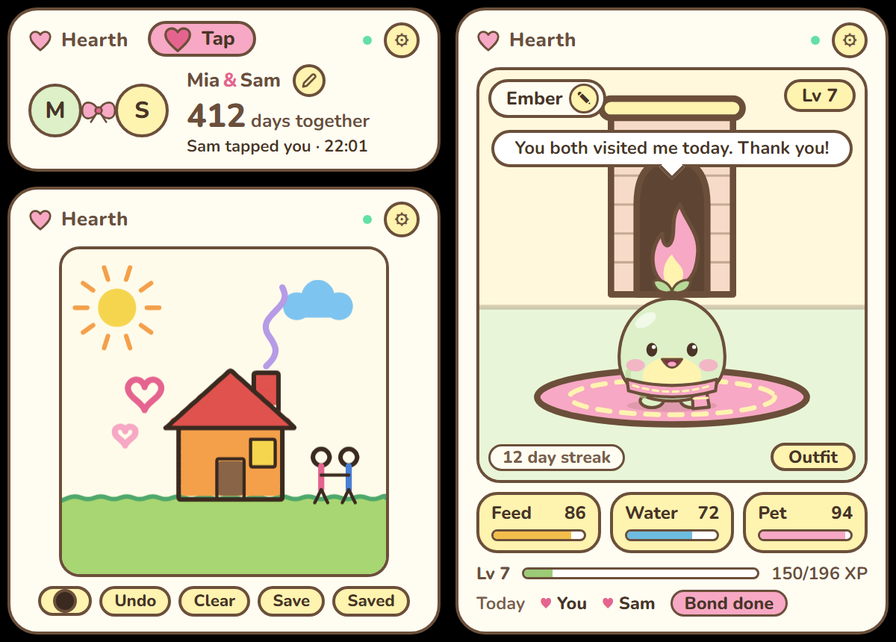

# Hearth

A small, cozy shared space for two people on two PCs. You pair once with a code, then each of you keeps Hearth on the
desktop: your names and how many days you have been together, a "thinking of you" tap, a drawing board you both paint
on, and a blob pet you look after together.

Hearth has **no location features, ever**. It never asks for, reads or sends where you are.

Hearth needs the Hearth routes on the relay to work at all. They live in `tools/umbra-relay/`, and nothing in this
repository deploys them; a maintainer has to.

## What it is

- **Us** (the Overview): your two names joined by a bow and **N days together**, counted in calendar days from your
  together-since date. It celebrates 100, 365, 500 and 1000 days, every 1000 days after that, and every anniversary.
- **Tap**: send "thinking of you". The other widget's heart pulses, and with notifications allowed a Windows toast
  appears with a **Tap back** button. If you both tap within about two minutes of each other, a special "you thought of
  each other at the same time" moment plays.
- **Board**: a drawing board you both paint on, kept on the relay so it is still there tomorrow. Colours, brush sizes,
  eraser, undo, clear (either of you can undo a clear for 60 seconds) and save as a picture.
- **Pet**: an original blob mascot you raise together. Feed, water and pet it. It gets sad when neglected but **never
  dies and never leaves**. A daily bond fills only when you both cared for it that day, and you earn levels and outfits.

## Getting started

1. Install Hearth from **Browse**. One of you chooses **Create our hearth** and gets a code (8 characters, valid for 10
   minutes, works once).
2. The other chooses **Join with a code** and types it.
3. The first time you click Hearth after pairing, Umbra asks whether Hearth may show notifications: **Allow** to get a
   Windows notification when your partner taps you, **Not now** to be asked after the next restart, or **Don't ask
   again**. You can change it any time in Settings > My widgets > Hearth. Each PC asks separately. Until you answer,
   the Tap view says "Click here to get a notification when ... taps you". With several copies, the toast comes from a
   copy whose notifications are on, so one copy switched off doesn't silence the rest.
4. Optional: in the Overview, use the pencil to set your own name and the together-since date. Each of you edits only
   your own name; either of you can change the date.

Both PCs need an internet connection. Offline, a widget shows an "Offline" chip and keeps its last data.

## Three tabs, one pairing

Once paired, the header has three small tabs between the name and the gear: **Us** (the Overview), **Board** and **Pet**.
Click one (or use the arrow keys on a focused tab) to switch; each copy remembers the tab you left it on. The **Opens on**
option picks the tab a copy starts with, and changing it moves the copy to that tab.

Sizes: a new Hearth starts tall (340 x 540), so all three tabs have room. You can also shrink it in edit mode to a small strip
(about 300 x 120) that suits Us; the Board then says "Make this widget bigger to draw". On the strip the Tap button sits at
the right of the header, as its heart. Copies installed before 1.8.0 keep their size.

You can still add more copies (Settings > My widgets > **Add another copy**), for example a small Us strip and a big Board
side by side. All copies on a PC share one pairing: a new copy that has no pairing shows **Use this PC's pairing**, and the
copy that is already paired then asks you to **Allow**. Only that click hands the pairing to the new copy.

Several copies on one PC cost no extra traffic: they talk to each other and only one of them asks the relay.

## Pairing, unpairing and "Invite again"

- **Unpair** (the gear button, then Unpair) leaves the hearth. Your partner keeps it **for 7 days** and sees "Your
  partner left this hearth". Within that time they can **Invite again** to make a new code, and anyone with that code
  re-joins. After 7 days the relay deletes everything.
- **Invite again** also moves your partner to a **new PC** (or after a reinstall): open Hearth settings on the PC that is
  still paired, choose Invite again, and type the new code on the new PC. Their old PC is signed out immediately, even
  if the code is never used. The new PC downloads the names, drawing and pet from the relay. The side that unpaired
  cannot invite itself back; the side that stayed does it.
- If a PC's pairing stops working (for example the room was deleted), the widget forgets it and says so.

## What leaves your PC (and what the relay keeps)

Hearth talks to one server only: the Umbra relay (`umbra-buddy-relay.umbra-server.workers.dev`, the only host in
`permissions.hosts`). The relay is a small Cloudflare Worker whose source is in [`tools/umbra-relay/`](../../tools/umbra-relay/README.md).

**Sent to the relay and stored there**

- Random ids: a room id, your side (a or b) and a secret key, created when you pair. They are how the relay knows which
  hearth a request belongs to. The key travels in the request URL.
- The names you typed, the together-since date, and the pet's name.
- Your drawing: for each stroke the colour number, brush size number and the points.
- Taps: how many each of you has sent and when.
- Pet state: food, water and love levels, level and xp, the daily bond and streak, and when you each last cared for it.

**Never sent or stored:** your location, an account, an email address, your IP address (as stored data), your
Windows name, or anything else from your PC.

**How long it is kept**

| What | How long |
|---|---|
| A pairing code | 10 minutes, or until it is used |
| A hearth that is in use | until it has gone **30 days** without any activity from either PC, then everything is deleted |
| A hearth after someone unpairs | **7 days**, then everything is deleted |
| Drawing | newest 300 strokes (20,000 points) per hearth; older strokes are dropped. A cleared board is kept 60 seconds so it can be undone, then deleted |

**Stored only on your PC** (in this widget's `umbra.store`, never sent): the pairing itself, a snapshot so the widget can
paint before the network answers, which tap and milestone messages you have already seen, your last colour and brush,
the pictures you saved from the Board (the last 6 here, all of them as files in `Pictures\Umbra\Hearth`), and the pet outfit you chose.

### Privacy, in plain language

The person who runs the relay can technically see everything in the "stored" list above: your names, your dates, your
drawings, and your pet's state and care times. There are no accounts, so they cannot tell who you are from the data
alone, but the names and drawings are not encrypted against them. Cloudflare, which hosts the relay, also keeps its own
request logs (including URLs and IP addresses) under its own policy. Anyone who has your room id and key can read and
change your hearth, which is why a code works only once and the key is random.

For the default host, the relay is run by the Umbra maintainer on Cloudflare. If you would rather not trust anyone with
this, run your own relay.

### Run your own relay

The server code is `tools/umbra-relay/`. Its README ([`tools/umbra-relay/README.md`](../../tools/umbra-relay/README.md)) is
the contract: routes, retention, request budget, deploy steps and what to set up around rate limiting. In short:

1. Deploy it with `npx wrangler deploy` from `tools/umbra-relay` (you need a Cloudflare account).
2. Point Hearth at the new host. It is written in **two** places: `HOST` in `hearth-core.js` and `permissions.hosts` in
   `widget.json`. Bump the widget `version`, run `node scripts/catalog.mjs` and install your folder (see
   [CONTRIBUTING.md](../../CONTRIBUTING.md)). Buddy has its own host setting.

A new relay starts empty, so a self-hosted hearth cannot reuse a pairing made on the default host.

## Known limitations

- **Needs the relay.** Without it Hearth cannot sync and shows "Offline". The Hearth routes are deployed on the default
  host and were tested end to end against it; the widget's own tests use a fake relay that follows the relay README.
- **Pairing is shared between copies through a workaround.** `umbra.store` is per copy, so copies on one PC pass the
  pairing around over a browser `BroadcastChannel`, and the paired copy must be allowed once (the **Allow** click
  above). The channel does connect separate WebView2 windows: a new copy offers **Use this PC's pairing**. The Allow
  click itself needs a person to try it.
- **Outfit choice is not synced.** The relay has no outfit field, so the pet outfit you pick is saved on your PC only;
  your partner sees their own choice. Outfits unlock by pet level and by days together.
- **Pet "day" is a UTC day.** The daily bond resets at midnight UTC, which can be an odd hour of the day where you live.
- **Board and Pet need a tall widget.** A new Hearth starts tall; a copy you shrank to the strip (or one from before 1.8.0) needs resizing by hand, and the Board cannot draw on the strip.
- **Board details.** The relay has no eraser, so the eraser paints in the paper colour and uses up strokes like any other
  drawing. The relay's palette is 16 colours and 8 brush sizes. Strokes not yet acknowledged when you close the widget
  are lost. The gallery keeps your newest 6 pictures, and **every picture you save is also written as a PNG to
  `Pictures\Umbra\Hearth`** (made on the first save), so the gallery is only the latest few and the folder is the backup. To use
  another folder, open Settings > My widgets > Hearth (Change..., Open, Use default). Pictures saved before this version move to
  the folder when the gallery pushes them out; if that fails, nothing is removed. Hearth can't read the folder back. Needs an Umbra
  with `umbra.images`; an older Umbra asks before the oldest picture is removed, and offers "Keep it in a folder".
- **Tap cooldown is per copy** (10 seconds), and the Windows toast is limited to a few per 10 minutes.
- **Font coverage.** The bundled Nunito covers most Latin alphabets. Names in other scripts use a font your PC has, and
  Vietnamese names can mix the two.
- **Request budget.** On Cloudflare's free plan the relay allows 100,000 requests a day, shared with Buddy, which is
  roughly 25 couples by the relay README's estimate (an estimate, not a measurement). When the quota is used up, widgets
  show "Offline" until midnight UTC. Rate limiting is only documented, not set up.
- **Things that need a human with real hardware:** dragging, Win+D, multi-monitor, the real toast and the pen or mouse
  feel on the Board.

## Files

`widget.json` (manifest and the `View` option), `index.html`, `hearth.js` (the shell and pairing screens),
`hearth-core.js` (relay client, pairing, sync, polling), `hearth.css`, `mascot.js` and `mascot.css` (the blob),
`overview*.js/css`, `tap*.js/css`, `board*.js/css` and `pet*.js/css` (the views), `nunito-*.woff2` and `OFL.txt`
(the font and its licence, Nunito by The Nunito Project Authors), `icon.png` and `preview.png`.

`preview.png` is a composite of the three views, because `umbractl capture` takes one widget at a time and needs a live
relay to show anything but "Offline". The names and the drawing in it are made up.
